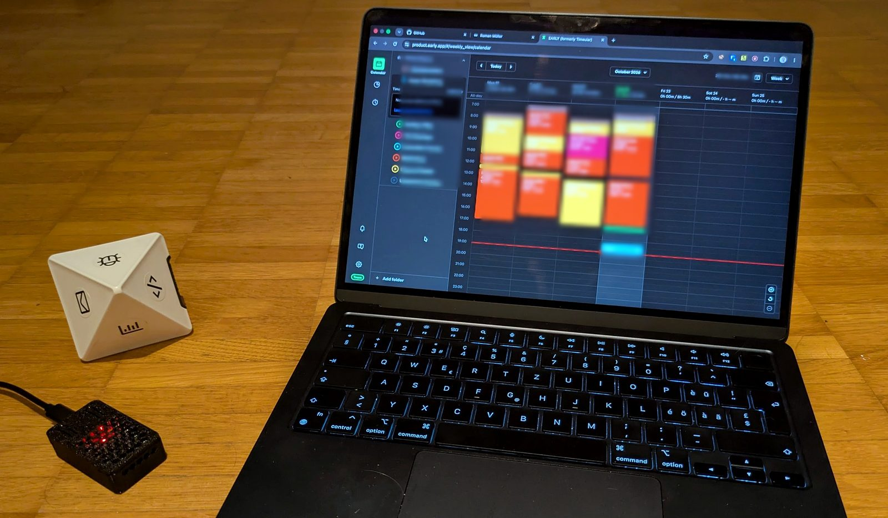

# early-cube-bridge

## Why

I track my working time with the [EARLY](https://early.app) cube: flip it to the side of what I'm working on, put it in the cradle when I stop. Then our IT asked me to remove the EARLY desktop app from my work laptop, which is what the cube talks to over Bluetooth. I didn't want to give up the cube, and pairing it with my phone instead wasn't an option either, so I put a small ESP32 next to it. It does the app's job and talks to EARLY directly. Nothing has to be installed on the work laptop, where I only open the EARLY web app to review my times.



## What it does

Use the [EARLY](https://early.app) (formerly Timeular) time-tracking cube without the EARLY desktop app. An ESP32 listens to the cube over Bluetooth LE and calls the [EARLY public API](https://developers.early.app/) over WiFi: flipping the cube stops the running entry and starts the activity mapped to the new side. Putting the cube in its cradle stops tracking.

Tested with an ESP32 DevKit (ESP-WROOM-32) and a Timeular Tracker (model TZ02K016, firmware 2.0.0). The firmware only builds for that board (`esp32dev`); the scanner also has a `c3` environment for an ESP32-C3 Super Mini.

## How it works

The cube needs no pairing. It exposes the side facing up as a single byte (1-8, 0 in the cradle) on characteristic `c7e70012-c847-11e6-8175-8c89a55d403c` (service `c7e70010-…`) and sends an indication on every flip. The bridge waits 2 s for the cube to settle, then calls `POST /tracking/stop` and `POST /tracking/{activityId}/start`, both with the time of the flip.

Before switching, the bridge checks `GET /tracking`: if the activity for the side is already running, it leaves it alone. So after a restart or a lost connection the bridge simply syncs EARLY to the cube without splitting the current entry. EARLY doesn't keep entries shorter than a minute, so a tracking that ran for less than that is cancelled with `DELETE /tracking` instead of stopped. Any other failure is retried every 10 s; a running entry is never deleted because a call failed.

If WiFi or the API is down, the bridge keeps retrying the side the cube is on and records it with the time of the flip once it gets through. Only the latest side is kept: if you flip the cube several times during an outage, the sides in between are lost.

The clock comes from NTP, or from the `Date` header of the API's responses where NTP is blocked.

## Status LED

The blue LED on the DevKit (GPIO 2):

| LED | Meaning |
| --- | --- |
| fast blink | no WiFi |
| slow blink | cube not connected |
| double blink | the last side couldn't be sent to EARLY (API error or no clock); it is retried |
| short flash every 5 s | all good |

## Setup

The cube connects to one device at a time, so disconnect it from the EARLY phone or desktop app first (the scanner in step 3 needs it free too).

1. Create an API key and secret in the EARLY web app (Settings → API).
2. `cp firmware/include/config.example.h firmware/include/config.h` and fill in your WiFi networks (several are fine, e.g. home and work), API key and secret, and the activity id for each side. List your activities with:
   ```sh
   TOKEN=$(curl -s -X POST https://api.early.app/api/v4/developer/sign-in \
     -H 'Content-Type: application/json' -d '{"apiKey":"…","apiSecret":"…"}' | jq -r .token)
   curl -s https://api.early.app/api/v4/activities -H "Authorization: Bearer $TOKEN" | jq '.activities[] | {id, name}'
   ```
3. To find which number each side reports, flash `scanner/` and flip the cube; it logs every side change over serial:
   ```sh
   cd scanner && pio run -e esp32 -t upload && pio device monitor
   ```
4. `cd firmware && pio run -t upload`. To see what the bridge does, run `pio device monitor` in `firmware/`; it logs every side, API call and error.

### Network requirements

- 2.4 GHz WiFi with WPA2-Personal. Captive portals and 802.1X (company login) networks don't work.
- Outbound HTTPS to `api.early.app`. NTP (UDP 123) is used if it's reachable but not required.

### Security

The API key and secret are stored in plain text in the firmware. Anyone with physical access to the board can read them from flash, and with them, your EARLY time entries. If you lose the board, generate a new key pair in the EARLY web app; that makes the old one invalid.
